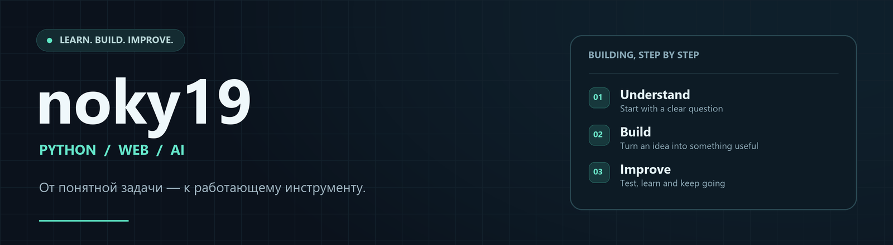

  

### Привет, я noky19 👋

Знаю Python и занимаюсь веб-разработкой. Создавал сайты и небольшие игры для ПК. Люблю пробовать новые инструменты и превращать идеи в работающие вещи.

Особенно увлекаюсь искусственным интеллектом: мне интересно разбираться, что он умеет и как помогает в разработке. Люблю момент, когда идея из головы впервые начинает работать на экране.

### Что мне интересно

- **Веб-разработка** — сайты, приложения и то, что происходит за их интерфейсом.
- **Искусственный интеллект** — новые инструменты, эксперименты и применение в своих задачах.
- **Игры и автоматизация** — небольшие проекты ради интереса и полезные штуки для повседневных дел.

### Что здесь будет

Мои проекты, эксперименты с ИИ и небольшие инструменты. Постепенно собираю здесь свои работы и идеи.

`Python` · `Web` · `AI` · `Building things`

---

Пишу код. Исправляю баги. Иногда создаю новые.

